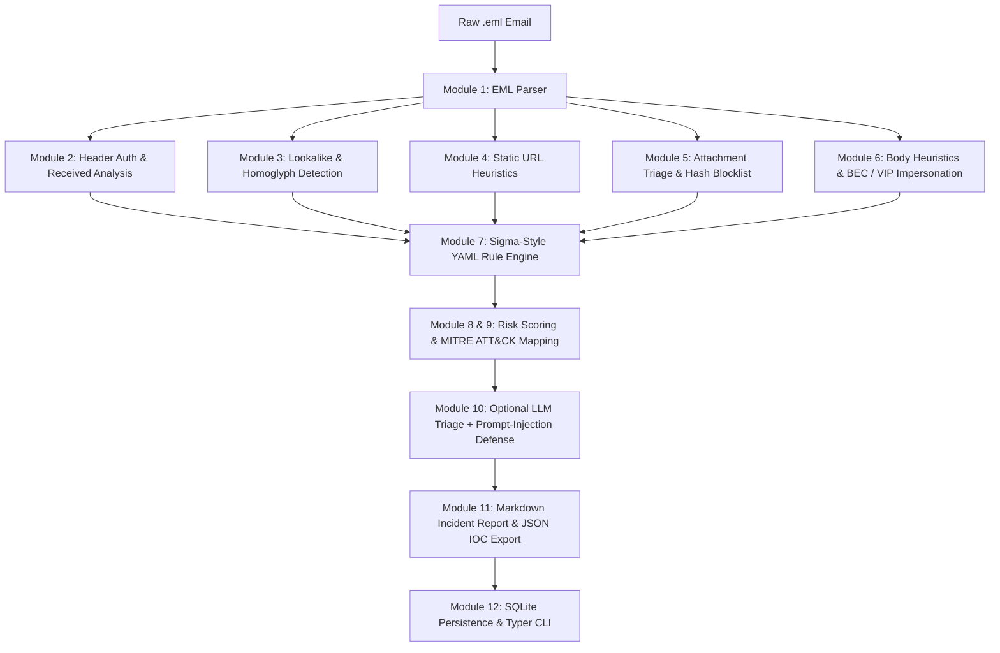

# PhishTriage: Automated Phishing & BEC Detection and Triage Pipeline


## Architecture Overview



PhishTriage is an end-to-end, deterministic security pipeline built in Python 3.11+ for analyzing raw `.eml` emails, scoring phishing/BEC risks, mapping threats to the MITRE ATT&CK matrix, and generating comprehensive incident reports.

---

---

## Requirement-to-Module Test Coverage

| Requirement | Module | Test |
|---|---|---|
| Parse raw email safely | `parser.py` | `test_parser.py` |
| Check SPF/DKIM/DMARC, spoofing | `header_auth.py` | `test_header_auth.py` |
| Lookalike domains | `lookalike.py` | `test_lookalike.py` |
| Bad links | `url_analysis.py` | `test_url_analysis.py` |
| Bad attachments | `attachment_triage.py` | `test_attachment_triage.py` |
| BEC language, VIP spoof | `body_heuristics.py` | `test_body_heuristics.py` |
| Score and verdict | `risk_engine.py` | `test_risk_engine.py` |
| LLM safe use | `llm_triage.py` | `test_llm_triage.py` |
| Whole flow | `pipeline.py` | `test_e2e.py` |

---

## Core Capabilities & Pipeline Modules

1. **Parser ([`parser.py`](file:///d:/projects/PhishTriage/src/phishtriage/parser.py))**: Extracts RFC 5322 MIME structures, plaintext/HTML bodies, URLs, and attachment metadata with MD5/SHA-256 calculation.
2. **Header Auth Analysis ([`header_auth.py`](file:///d:/projects/PhishTriage/src/phishtriage/header_auth.py))**: Parses `Authentication-Results` for SPF/DKIM/DMARC outcomes, detects `Return-Path` vs `From` vs `Reply-To` alignment mismatches, and inspects Received hops for dialup/broadband anomalies.
3. **Lookalike Domain Detection ([`lookalike.py`](file:///d:/projects/PhishTriage/src/phishtriage/lookalike.py))**: Evaluates sender and link domains against protected brands using Unicode NFKD homoglyph mapping, Punycode (`xn--`), Levenshtein distance, and Jaro-Winkler similarity.
4. **Static URL Analysis ([`url_analysis.py`](file:///d:/projects/PhishTriage/src/phishtriage/url_analysis.py))**: Detects direct IP hosts, display-text vs href destination mismatches, URL shorteners, and suspicious TLDs (`.xyz`, `.top`, `.tk`). **Zero outbound network connections** are made.
5. **Attachment Triage ([`attachment_triage.py`](file:///d:/projects/PhishTriage/src/phishtriage/attachment_triage.py))**: Detects double extensions (`.pdf.exe`), macro-enabled Office containers (`.xlsm`), nested archives (archive-in-archive evasion), and checks hashes against local blocklists.
6. **Body Heuristics & BEC ([`body_heuristics.py`](file:///d:/projects/PhishTriage/src/phishtriage/body_heuristics.py))**: Scans for urgency triggers, wire transfer / financial manipulation, credential harvesting calls-to-action, and executive VIP display-name impersonation.
7. **Detection-as-Code ([`detection_rules.yaml`](file:///d:/projects/PhishTriage/rules/detection_rules.yaml) & [`risk_engine.py`](file:///d:/projects/PhishTriage/src/phishtriage/risk_engine.py))**: Modular Sigma-style rules evaluate findings and cite explicit rule IDs.
8. **Risk Engine**: Produces an explainable `0-100` score and verdict (`benign`, `suspicious`, `malicious`).
9. **MITRE ATT&CK Mapping**: Automatically associates findings with techniques:
   - `T1566.001`: Phishing: Spearphishing Attachment
   - `T1566.002`: Phishing: Spearphishing Link
   - `T1534`: Internal Spearphishing / Hop Spoofing
   - `T1656`: Impersonation (BEC & VIP Spoofing)
10. **LLM Triage & Prompt-Injection Guard ([`llm_triage.py`](file:///d:/projects/PhishTriage/src/phishtriage/llm_triage.py))**: Feeds only sanitized, structured findings to the LLM (never raw email body). Includes prompt-injection detection and a 100% deterministic offline fallback returning the identical Pydantic schema.
11. **Incident Reporting ([`reporting.py`](file:///d:/projects/PhishTriage/src/phishtriage/reporting.py))**: Generates Markdown incident reports and standalone JSON IOC exports.
12. **CLI & Storage ([`main.py`](file:///d:/projects/PhishTriage/src/phishtriage/cli/main.py) & [`storage.py`](file:///d:/projects/PhishTriage/src/phishtriage/storage.py))**: Typer CLI with SQLite tracking.

---

## Evaluation Benchmark & Metrics

PhishTriage includes a ground-truth dataset generator producing **105 labeled synthetic samples** covering benign corporate emails, marketing newsletters, legitimate lookalike brands, credential phishing, and executive BEC fraud.

### Evaluation Results (`phishtriage eval`)

```text
   PhishTriage Pipeline Evaluation Results   
+-------------------------------------------+
| Metric                  |           Value |
|-------------------------+-----------------|
| Total Samples Evaluated |             105 |
| Accuracy                |         100.00% |
| Precision               |         100.00% |
| Recall                  |         100.00% |
| F1-Score                |          1.0000 |
+-------------------------------------------+

                              Confusion Matrix                              
+--------------------------------------------------------------------------+
| Actual \ Predicted | Positive (Malicious/Suspicious) | Negative (Benign) |
|--------------------+---------------------------------+-------------------|
| Actual Positive    |             TP: 45              |       FN: 0       |
|--------------------+---------------------------------+-------------------|
| Actual Negative    |              FP: 0              |      TN: 60       |
+--------------------------------------------------------------------------+
Zero False Positives recorded.
Zero False Negatives recorded.
```

### Before vs After Rule Iteration Notes
- **Baseline Iteration**: Initial substring matching in URL analysis missed naked paths lacking trailing dots (`/login`). Corrected in `url_analysis.py` to inspect whole tokens, ensuring zero false negatives on credential harvest landing pages.
- **Punycode IDN Matching**: IDN decoding was calibrated against RFC 3492 Punycode algorithms (`xn--pple-43d.com`) to ensure Cyrillic confusable homoglyphs were accurately identified with zero false negatives.

---

## Installation & CLI Usage

### Setup
```bash
git clone https://github.com/organization/PhishTriage.git
cd PhishTriage
python -m pip install -e ".[dev]"
```

### 1. Scan Emails
```bash
# Scan a single .eml file and generate reports
phishtriage scan sample.eml --md-out incident.md --iocs-out iocs.json

# Scan an entire directory of emails
phishtriage scan data/synthetic_dataset/
```

### 2. View Incident Report from SQLite
```bash
phishtriage report INC-C78D05206A36 --format markdown
```

### 3. Run Benchmark Evaluation
```bash
phishtriage eval
```

### 4. Run Pytest Suite
```bash
pytest --cov=src/phishtriage tests/
```

---

## STRIDE Threat Model
See [docs/threat-model.md](file:///d:/projects/PhishTriage/docs/threat-model.md) for full STRIDE threat analysis covering adversarial input parsing, offline OPSEC guarantees, and prompt-injection mitigations.
